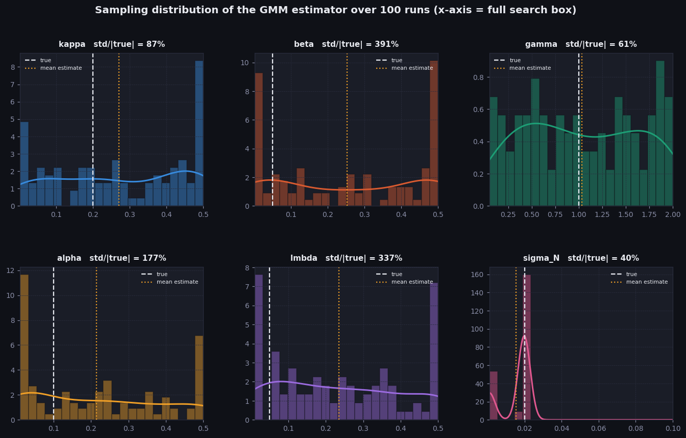
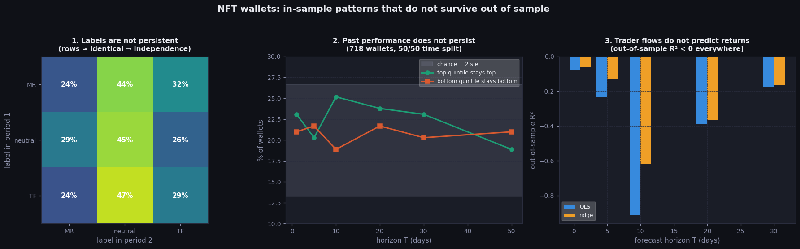

# Agent-based market models and NFT trader behaviour

**Calibrating a fundamentalist/chartist agent-based model by Simulated Method of Moments, and testing on 2.4 M NFT sales whether traders' behaviour carries predictive information.**

CentraleSupélec · ST4 *Statistical Data in Finance* · one-week team project (*EI*), June 2026

   

---

## Key results

| | Finding |
|---|---|
| **Fast simulator** | Modified Chiarella model compiled with Numba: 1,000 paths of 1,500 steps in ~0.05 s, which makes 100 full GMM re-estimations run in ~25 s on a laptop. |
| **Optimiser choice under noise** | 9 optimisers benchmarked on a stochastic GMM objective (coefficient of variation ≈ 60% at a fixed point). Finite-difference gradients fail; COBYLA/COBYQA always report convergence, but differential evolution reaches the lowest losses: an optimiser's `success` flag is a poor selection criterion on a noisy objective. |
| **Identifiability** | Over 100 independent re-estimations, **only the noise level σ_N is recovered** (74% of runs within ±10%). The five behavioural parameters are not identified: their estimates spread over the whole search box. Root cause: at these parameter values, the noise is **50–180× larger** than the agents' price impact. Surrogates (XGBoost, R² = 0.99) and surrogate-assisted ABC confirm it: posterior = prior for all five. |
| **NFT market structure** | Activity per wallet is heavy-tailed (α ≈ 2.2, exponential rejected; log-normal not). In-sample, 48% of 9,649 active wallets react significantly to the previous day's return, split evenly between trend-following and mean-reverting. |
| **Out of sample, nothing survives** | Wallet labels in the second half are independent of labels in the first half; top-quintile traders stay on top at the chance rate (19–25% vs 20%); aggregate flows give a **negative out-of-sample R²** at every horizon; the agent-based forecaster's directional hit-rate is 47.8%. |

<p align="center"><br>
<em>Sampling distribution of the GMM estimator over 100 re-estimations (x-axis = full search box). Only σ_N concentrates around the true value (dashed line).</em></p>

<p align="center"><br>
<em>NFT wallets: the in-sample behavioural patterns do not survive out of sample.</em></p>

---

## The three notebooks

### [01 · Calibrating an agent-based model by SMM](notebooks/01_abm_calibration.ipynb) (fully reproducible, ~80 s)

The price results from *fundamentalists* (cubic pull towards a value $v_t$, itself an EMA of past prices) and *chartists* (saturated trend following):

$$p_{t+1} - p_t = \kappa\bigl[(v_t - p_t)^3 - (v_{t-1} - p_{t-1})^3\bigr] + \beta\bigl[\tanh(\gamma m_t) - \tanh(\gamma m_{t-1})\bigr] + \sigma_N\,\eta_t$$

- **Estimator**: 6 stylised-fact moments (variance, kurtosis, 99% quantile of |r|, ACF of r and r², skewness), normalised distance, iterative optimal weighting $W = \hat V^{-1}$ (Hansen, 1982).
- **Optimiser benchmark** on a noisy objective, with a fixed selection rule and a critical look at it.
- **Monte Carlo study**: 100 re-estimations → bias, std, RMSE, sloppiness. The original team conclusion ("average the 100 estimates") is corrected: when the estimator is uniform on the box, the average converges to the centre of the box, not to the truth.
- **Alternatives**: random-forest and XGBoost surrogates, surrogate-assisted ABC on a Sobol design, and a proof (symmetry argument + experiment) that fitting the deterministic trajectory to an averaged path cannot identify anything.

### [02 · NFT trader behaviour](notebooks/02_nft_trader_behaviour.ipynb) (2.4 M sales, outputs of the original run)

Power-law vs log-normal tests (Clauset et al.), per-wallet Pearson classification of inventory changes against lagged returns, transition matrices, reaction horizons, directional PnL / Sharpe, persistence on a 50/50 split, linear and ridge forecasts of market returns from wallet flows. Ends with an explicit **limitations** section (composition-driven price index, multiple testing, overlapping horizons, two data-quality bugs found during the review).

### [03 · Forecasting: HMM and agent-based state-space model](notebooks/03_regime_prediction.ipynb) (outputs of the original run)

- **Two-state HMM** (Baum–Welch, forward filter, Viterbi), validated on synthetic data with known regimes: 75.2% one-step-ahead state accuracy vs a 55% majority baseline. The regimes it identifies are volatility regimes; the drifts are not identifiable.
- **Chiarella model as a state-space model on real data**: rolling SMM calibration (differential evolution), SIR particle filter on $(p_t, m_t, v_t)$, 1,000-path Monte-Carlo forecasts over 35 windows: 47.8% directional hit-rate, i.e. no skill.
- The original slides compared those two numbers as if they measured the same thing; they do not, and the notebook says so up front.

---

## What I would do next

1. **Dynamic moments** (multi-lag ACFs of r and |r|, variance ratios) and calibration in a regime where agents matter, reporting identifiability as a function of the agents' signal-to-noise ratio.
2. **A proper NFT price index** (collection-level floor prices or repeat-sales) instead of the daily median of all sales, whose 50%/day volatility is mostly composition noise.
3. **Multiple-testing control** (Benjamini–Hochberg) and HAC standard errors for the wallet-level tests.
4. **Volatility rather than direction**: evaluate the HMM on the real series against GARCH/EWMA with a QLIKE loss, and check forecast-distribution calibration with coverage tests.

---

## Repository

```
├── notebooks/
│   ├── 01_abm_calibration.ipynb        # synthetic data — re-executed end to end
│   ├── 02_nft_trader_behaviour.ipynb   # real data — original outputs
│   └── 03_regime_prediction.ipynb      # real + synthetic data — original outputs
├── src/abm/                            # simulator, moments, SMM/GMM toolkit (Numba)
├── figures/                            # figures used in this README
├── scripts/                            # notebook build/execution helpers
├── data/README.md                      # dataset description (data not included)
└── docs/slides.pdf                     # final presentation (team)
```

**Reproduce notebook 01**

```bash
python -m venv .venv && source .venv/bin/activate
pip install -r requirements.txt
python scripts/execute.py notebooks/01_abm_calibration.ipynb
```

Notebooks 02 and 03 need the course dataset `sales.csv` in `data/` (not redistributed).

---

## Team and contribution

Team **Oysters with Shallots**: Matisse Dezileau, Archange Djetouan, Mohamed Aziz Medini, Tanguy Figuières, Rayan Neffati.

**My contribution:** the SMM/GMM calibration pipeline (Numba simulator, moments, optimiser benchmark, optimal GMM, 100-run sloppiness study, surrogate and S-ABC) and the NFT trader-behaviour analysis (notebook 02). After the project, I restructured the repository, re-ran the calibration study and reviewed every conclusion against its numbers, which led to the corrections described above. The trajectory-fitting experiment and the forecasting notebook build on teammates' work.
